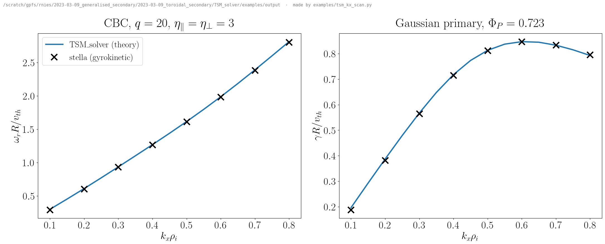
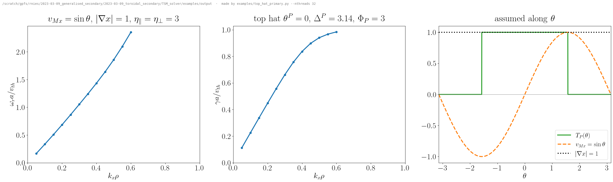

# TSM_solver

Solver for the dispersion relation of **toroidal secondary modes** (TSMs) and the other secondary
instabilities of zonal flows: Nies & Parra, *Theory of zonal flow growth and propagation in toroidal
geometry*, Plasma Phys. Control. Fusion **68** (2026) 045028. Given a frozen streamer primary mode
(amplitude, temperature perturbations, variation along the field line) and a flux-tube geometry
(Miller, VMEC, or the geometry of a stella run), it finds the complex frequency $`\omega`$ of the zonal
secondary mode at radial wavenumber $`k_x`$. The Python package is called `tsm_disp`.



*The example below: circular Cyclone Base Case surface ($`q = 20`$), $`\eta_\parallel = \eta_\perp = 3`$,
Gaussian primary; lines from this solver, crosses from stella gyrokinetic simulations of the same case.*

## Installation

Requirements: Python ≥ 3.8 and a C compiler (gcc, clang or Intel). Numpy, scipy and Cython (< 3) are
installed automatically.

```bash
git clone https://github.com/richardnies/TSM_solver.git TSM_solver
cd TSM_solver
pip install ".[plot]"          # or: pip install -e ".[plot,test]" to develop and run the tests
```

Optional extras: `stella` (f90nml, netCDF4: read stella runs and decks), `vmec` (simsopt: VMEC
equilibria), `plot` (matplotlib, for the examples), `test` (pytest, mpmath). The build uses OpenMP when
the compiler supports `-fopenmp` and prints `building with OpenMP`; otherwise it runs single-threaded
(Apple clang: install `libomp` or set `CC=gcc-13`). Without installing, `python setup.py build_ext --inplace`
builds the extension inside the source tree.

## Quickstart

```bash
python examples/tsm_kx_scan.py              # ~20 s on 32 cores, ~30 s on 8, a few minutes on 1
```

It follows the most unstable TSM from $`k_x\rho_i = 0.5`$ up to 0.8 and down to 0.1 and writes
`examples/output/tsm_kx_scan.txt` ($`k_x`$, $`\omega_r`$, $`\gamma`$) and the figure above. Options:
`--Phi-P` (primary amplitude), `--q`, `--kx-min/--kx-max/--dkx`, `--guess` (initial ω at `--kx-start`),
`--nthreads`, `--tol`; see `--help`.

The core of the example in a few lines:

```python
import numpy as np
from tsm_disp.geometry import miller
from tsm_disp.primary import Primary
from tsm_disp.dispersion import DispersionRelation
from tsm_disp.roots import find_root

geo = miller(rhoc=0.5, rmaj=2.77778, qinp=20, shat=0.8, zed_equal_arc=True)   # flux tube
pri = Primary.gaussian(Phi_P=0.723, width=np.pi)                                # frozen primary
disp = DispersionRelation(geo, pri, tau=1, eta_par=3, eta_prp=3, nthreads=8)  # D(ω, k_x)
root = find_root(lambda w: disp.D(w, 0.5), 0.58 + 0.29j)                        # D = 0 near a guess
print(root.omega)            # ≈ 0.5808 + 0.2927j  (units v_th/a, v_th = √(2T/m))
```

**Mode structure.** `disp.mode_structure(omega, kx, quantity)` returns the eigenmode on the flux surface
(field-line coordinate × primary phase y) for `quantity` = `"potential"` ($`\hat\phi = \langle\phi\rangle_\psi/D_{\rm ISM}`$),
`"pressure"` ($`\hat P = T\int d^3v\,(v_\parallel^2+v_\perp^2/2)/v_{th}^2\,\hat g`$, paper eq. 38) or `"heat_flux"`
($`\hat Q_{NL} = v_{Ex}^P \hat P`$, eq. 40, whose $`y`$ average carries the up–down asymmetry that drives the TSM),
normalised to $`Ze\langle\phi\rangle_\psi/T = 1`$; `phi_average` = 1 checks that ω is a root.
`python examples/mode_structure.py` plots all three for the example case.

**Finding a first root.** Roots are followed by continuation, so a scan needs one good initial guess. Good
guesses: for the TSM, $`\omega_r \approx 2k_x\rho_i v_{th}/R`$ with $`\gamma`$ a fraction of it; for the GAM
($`\Phi_P \to 0`$), `tsm_disp.limits.omega_GAM(geo, kx)`; for the purely growing RDK mode (no drift),
`limits.omega_RDK_smallb`. `find_root` returns `converged = False` when it fails; try another guess.
Roots should not be trusted where `DispersionRelation.D_ism` vanishes on the surface (the paper's ISM
region, where $`D`$ is not analytic).

## Equations

The secondary (zonal, wavenumber $`k_x`$) of a frozen streamer primary $`v_{Ex}(z,y) = -\Phi_P T_P(z)\sin y`$
obeys (paper eqs. 31–32)

```math
D(\omega,k_x) = 1-\Big\langle \frac{1}{D_{\rm ISM}}\Big\rangle = \int dz\, w(z)\,\frac{1}{2\pi}\int_{-\pi}^{\pi}dy\,\frac{D_{\rm ISM}-1}{D_{\rm ISM}} = 0,
\qquad D_{\rm ISM} = \frac{1-\Gamma_0(b)+\tau-N}{\tau},
```

with $`w = 1/(\mathbf B\cdot\nabla z)`$ normalised to $`\int w\,dz = 1`$, $`b = k_x^2|\nabla x|^2\rho^2/2`$ and the ion response

```math
N=\int d^3\hat v\,\hat F_M J_0^2(\sqrt{2b}\,\hat v_\perp)\,
\frac{\omega_1+2\omega_2\hat v_\parallel^2+\omega_3\hat v_\perp^2}{\bar\omega-\omega_{M}(\hat v_\parallel^2+\hat v_\perp^2/2)},\qquad
\begin{aligned}
&\bar\omega=\omega-\omega_E,\quad \omega_E = k_x v_{Ex},\quad \omega_M = k_x v_{Mx},\\
&\omega_1=\tau(-\omega_E+\tfrac12\eta_\parallel\omega_{E\parallel}+\eta_\perp\omega_{E\perp}),\quad
\omega_2=\tfrac12(\omega_M-\tau\eta_\parallel\omega_{E\parallel}),\quad \omega_3=\tfrac12\omega_M-\tau\eta_\perp\omega_{E\perp},
\end{aligned}
```

where $`\omega_{E\parallel,\perp} = \omega_E(y+\Delta_{\parallel,\perp})`$ carry optional phase shifts. Two evaluations of $`N`$:

* **λ form** (`form="lambda"`, old `disp_model < 0`): the Laplace representation (paper eq. 34), exact in $`b`$.
  The λ contour is chosen per point (straight ray $`\lambda = is/\bar\omega`$ with Gauss–Laguerre or adaptive
  Gauss–Kronrod; a real segment plus ray near the resonance; a detour around the singularities
  $`\lambda = i/\omega_M,\,2i/\omega_M`$ for the Landau continuation to $`{\rm Im}\,\bar\omega<0`$).
* **Z form** (`form="Z"`, old `disp_model = 0.1`): the $`O(b)`$ closed form in the plasma dispersion function,
  $`\zeta=\sqrt{\bar\omega/\omega_M}`$ on the sheet continuous with $`{\rm Im}\,\bar\omega>0`$. For $`|\zeta|\ge 6`$ the J
  functions use a 48-term cancellation-free asymptotic series (`scripts/derive_J_asymptotics.py`).

**Units** (stella): lengths in $`a`$, wavenumbers in $`1/\rho_{\rm ref}`$, velocities in $`v_{th}=\sqrt{2T/m}`$,
frequencies in $`v_{th}/a`$. Multiply frequencies by $`R/a`$ for the paper's $`v_{Ti}/R`$.

**Analytic continuation.** For $`{\rm Im}\,\omega\le 0`$ the $`y`$ integral runs on $`y = t + i\,{\rm sgn}(A)\,\eta\cos t`$,
which keeps the branch points ($`\bar\omega = 0`$) on the side they occupy for $`{\rm Im}\,\omega>0`$. This is the analytic
continuation of $`D`$ wherever $`D_{\rm ISM}`$ has no zeros near the contour. Inside the paper's ISM region
($`D_{\rm ISM}=0`$ somewhere on the surface) $`D`$ is not analytic, and no contour is attempted (paper §3.3).
Near-real zeros of $`D_{\rm ISM}(y)`$ are located by Newton's method and their poles subtracted analytically
(flag 64), which keeps the cost bounded near the ISM region.

## Geometry (`tsm_disp.geometry`)

Only $`k_y=0`$ quantities enter: along the field-line coordinate $`z`$,

```math
v_{Mx} = \frac{\mathrm{gbdrift0}}{2\hat s},\qquad
\frac{|\nabla x|^2}{B^2} = \frac{\mathrm{gds22}}{\hat s^2\,\mathrm{bmag}^2},\qquad
w \propto \frac{1}{\mathrm{bmag}\cdot\mathrm{gradpar}} ,
```

in stella's conventions: stella advances $`\partial_t g + i\omega_d g = \dots`$ with
$`\omega_d = (k_x/\hat s)(\mathrm{cvdrift0}\,v_\parallel^2+\mathrm{gbdrift0}\,v_\perp^2/2)/2`$ and
$`\phi\propto e^{-i\omega t}`$, and `cvdrift0` = `gbdrift0`. For the circular CBC this gives
$`v_{Mx} = -\sin\theta/R`$, the mirror
image of the old `T_D = sin θ/2.7778`; the two are equivalent for up-down-symmetric problems.

| constructor | source | verified against |
|---|---|---|
| `AnalyticGeometry(vMx, gradx=1, B=1, jacobian=1/B, breakpoints=())` | functions of θ (callables or constants) | `CircularAnalytic` (1e-12) |
| `CircularAnalytic(eps, rmaj, vMx)` | the model of the original code | itself (regression) |
| `Uniform(vMx=0)` | slab / RDK limit | paper eq. (B.5) |
| `miller(rhoc, rmaj, rgeo, shift, qinp, shat, kappa, kapprim, tri, triprim, …, zed_equal_arc)` | port of stella's `geometry_miller.f90` | stella's `geometry_miller.*.output` (≤ 5e-9, its print precision) and `.out.nc` of equal-arc runs (≤ 1e-12) |
| `vmec(wout, torflux, alpha0, zeta_center, nfield_periods, nzed)` | simsopt `vmec_fieldlines`, stella's grid | stella's precise-QH run (≤ 2e-6) |
| `from_stella_run(run_dir)` | `<run>.out.nc` (or `<run>.geometry`, 4 digits) + input | Miller port (1e-6) |

Tokamak tubes with `nperiod = 1` are periodic (Fourier interpolation); VMEC tubes are not (field-line average).

**Analytic θ-variation.** Geometry and primary can both be given as functions of θ:
`AnalyticGeometry(vMx, gradx, B, jacobian)` and `Primary(T_P, Phi_P, breakpoints=[...])`, with `T_P` a
vectorised callable of θ; list discontinuities or sharp features in `breakpoints` (they become panel edges of
the θ integral). `Primary.top_hat(theta_P, Delta_P, Phi_P)` is 1 for $`|\theta-\theta^P| \le \Delta^P/2`$
(modulo 2π) and 0 otherwise. `python examples/top_hat_primary.py` (≈ 20 s on 32 cores) follows the TSM in
$`k_x`$ for $`v_{Mx} = \sin\theta`$, $`|\nabla x| = 1`$ and a top-hat primary ($`\theta^P = 0`$, $`\Delta^P = \pi`$,
$`\Phi_P = 3`$ by default; `--theta-P`, `--Delta-P`, `--Phi-P`, `--guess` to change them) until the root reaches
the ISM region:



```python
from tsm_disp.geometry import AnalyticGeometry
geo = AnalyticGeometry(vMx=np.sin, gradx=1.0)                    # B = 1, weight ∝ 1/B (b·∇θ uniform)
pri = Primary.top_hat(theta_P=0.0, Delta_P=np.pi, Phi_P=3.0)
disp = DispersionRelation(geo, pri, tau=1, eta_par=3, eta_prp=3, nthreads=8)
find_root(lambda w: disp.D(w, 0.3), 1.05 + 0.66j).omega         # 1.0535 + 0.6621i
```

## Amplitude conventions

stella's `secondary = .true.` initialises and freezes the primary coefficient at $`k_y^P = 1/y_0`$,

```math
g = \mathrm{phiinit}\;\phi_0(z)\left[\mathrm{den0} + \mathrm{tpar0}\,\big(v_\parallel^2-\tfrac12\big) + \mathrm{tperp0}\,\big(v_\perp^2-1\big)\right]F_M ,
```

whose potential has real-space amplitude $`2|\hat\phi|`$ and radial E×B velocity $`f_{\rm exb}\,\partial_y\phi`$, with
$`f_{\rm exb}`$ = `exb_nonlin_fac` (the ½ of $`v_{th}^2=2T/m`$ is inside it). Hence

```math
\Phi_P\,T_P(z) = 2 f_{\rm exb}\,k_y^P\,|\hat\phi(z)|,\qquad \eta_\parallel = \mathrm{tpar0},\quad \eta_\perp = \mathrm{tperp0}
```

(`primary.stella_phiP`). For the CBC surface $`2 f_{\rm exb} = 1/\sqrt{1-\epsilon^2} = 1.0166`$.
The historical drivers used $`\Phi_P = k_y^P \cdot \mathrm{phiinit} \cdot \mathrm{fac\_norm}`$ (`fac_norm` the RMS
normalisation of the Gaussian), so their solver curves had a 1.66 % weaker drive than the stella runs they were
compared with. Their plot label is $`\mathcal A = \Phi_P/0.3557`$; 0.3557 is the true amplitude of the reference
deck phiinit = 35, $`y_0 = 100`$ ($`2 \cdot 0.5083 \cdot 0.01 \cdot 35 = 0.3558`$).

The paper's eq. (21),

```math
A^P = \sqrt{\big\langle (v_{Ex} R / v_{Ti}\rho_i)^2 \big\rangle_\psi}\quad\text{(average over $z$ and $y$)},
```

is `primary.A_P`. For the Gaussian CBC primary $`A^P = (R/a)\,\Phi_P\sqrt{\langle T_P^2\rangle/2} = 2.024\,\Phi_P`$,
so a legacy label $`\mathcal A`$ corresponds to $`A^P = 0.732\,\mathcal A`$. The labels follow a different
convention from eq. (21), and the paper's quoted values should be checked against it.

### Amplitude from the primary heat flux

Instead of $`\Phi_P`$ or $`A^P`$, the primary can be set by its flux-surface-averaged ion heat flux $`Q`$ in
stella's normalisation (the `qflx` of the `.fluxes` file, gyro-Bohm units $`Q/(n T v_{th}\rho_*^2)`$).
A frozen primary carries heat flux only if its temperature perturbation is out of phase with $`\varphi`$
(phases $`\Delta_\parallel, \Delta_\perp`$; stella: $`\Delta = -`$`den0_phase`). stella's diagnostic
(`get_fluxes`: $`-s_\psi\,\tfrac12\,\mathrm{mode\_fac}\,k_y\,\mathrm{Im}[\int d^3v\,(v_\parallel^2+v_\perp^2)J_0 g\,\varphi^*]`$,
weighted with the Jacobian and divided by $`\langle|\nabla\rho|\rangle`$) gives, for $`k_y^P\rho \to 0`$ and $`T_e = T_i`$,

```math
Q = -s_\psi\,\Big(\tfrac12\eta_\parallel\sin\Delta_\parallel + \eta_\perp\sin\Delta_\perp\Big)\,
\frac{\Phi_P^2\,\langle T_P^2\rangle}{4 f_{\rm exb}^2\,k_y^P\,\langle|\nabla\rho|\rangle},
```

with $`s_\psi`$ = `sign_torflux` (−1 for Miller), $`f_{\rm exb}`$ = `exb_nonlin_fac` and $`\langle\cdot\rangle`$ the
field-line average. At fixed E×B amplitude $`Q \propto \Phi_P^2/k_y^P`$, so the primary's binormal wavenumber
must be given:

```python
pri = Primary.gaussian(1.0, width=np.pi).with_heat_flux(Q=1159, geometry=geo, ky_P=1e-3, eta_par=3, eta_prp=3,
                                                        delta_par=0.5, delta_prp=0.5)     # Φ_P = 0.7232
disp = DispersionRelation(geo, pri, eta_par=3, eta_prp=3, delta_par=0.5, delta_prp=0.5)  # same η and Δ
heat_flux_stella(pri, geo, 1e-3, 3, 3, 0.5, 0.5)                                         # → 1159
```

`python examples/tsm_kx_scan.py --Q 1159 --ky-P 0.001 --delta 0.5` does the $`k_x`$ scan this way.
Checked against 3-step stella runs of the frozen primary (`benchmarks/heat_flux/`, CBC and shaped Miller,
$`\Delta = \pm`$, $`\eta_\parallel = 0`$ or $`\eta_\perp`$ = 0, $`k_y^P`$ = 0.001 and 0.005): agreement to
1.0–1.1e-4 (stella's 5 printed digits) with `vperp_max = 4.5`. With stella's default `vperp_max = 3` its
$`v_\perp`$ integral is truncated and its `qflx` is 0.1–0.3 % low (the temperature perturbation leaks into the
density and $`\varphi`$ at the 1e-3 level).

## More usage

```python
from tsm_disp.geometry import miller, vmec, from_stella_run, CircularAnalytic
from tsm_disp.roots import scan_kx

geo = miller(rhoc=0.5, rmaj=2.77778, qinp=20, shat=0.8, kappa=1.5, kapprim=0.3, tri=0.3, triprim=0.5,
             shift=-0.2, zed_equal_arc=True)                               # shaped Miller surface
geo = from_stella_run("/path/to/stella/run")                                 # <run>.out.nc (or .geometry) + input
geo = vmec("wout_precise_QH.nc", torflux=0.635, alpha0=-1.08, zeta_center=0.39,
           nfield_periods=1.45, nzed=1024)                                   # needs simsopt
geo = CircularAnalytic()                                                     # the model of the original code

disp = DispersionRelation(geo, pri, tau=1, eta_par=3, eta_prp=3, form="lambda",  # or form="Z" (small b, fast)
                          epsabs=1e-8, epsrel=1e-8, nthreads=32)
scan = scan_kx(disp, np.linspace(0.1, 1, 10), root.omega)                   # continuation in k_x
disp.D_ism(omega, kx, z, y)                                                  # local response, eq. (31)
from tsm_disp.primary import stella_phiP, A_P, heat_flux_stella              # amplitude conversions
```

**Drivers of the original code** (`code_eval_disp_NEW/disp_rel.py`): point their `sys.path.append(...)` to
this repository; `disp_rel.py` here accepts the old function names and keywords (also `omegaN=`;
`a_int`, `Nintegrate`, `tol_adaptive`, `sing_ITG` are ignored). Set `TSM_DISP_NTHREADS` for OpenMP threads.

## Build and test

```bash
python setup.py build_ext --inplace
python -m pytest -m fast        # ~1 min
python -m pytest -m slow        # brute-force quadratures, limits, VMEC (~3 min)
```

Tests: λ form against two independent velocity-space quadratures in both half-planes, including the
Landau continuation (1e-12); continuity of the continued $`N`$ across the real axis; the Z form as the $`O(b)`$
expansion (error ∝ $`b^2`$); J functions against 50-digit mpmath; the paper's exact RDK relation (B.5) to
1e-11; the RDK growth rate; the GAM frequency (50) with a $`k_x^2`$ approach; the non-resonant relation (52);
reality and local symmetries; Cauchy's integral of $`D`$ across $`{\rm Im}\,\omega=0`$; the regression value of the
original code (Z form, 1e-12); the geometry ports against stella output; the compatibility shim.

## stella benchmark (`benchmarks/stella_cbc/`)

Journal: 2026-10-08_secondary-mode-solver-rebuilt-old-lambda-form-had

CBC, $`q=20`$, $`\eta_\parallel=\eta_\perp=3`$, Gaussian primary (width π in zed), Θ = 0.2886 stella runs
(`fig_stella_q20.pdf`, `fig_stella_q20_dev.pdf`; data `data_caseA_label*.json`). Deviation from stella:

| variant | $`\omega_r`$ | $`\gamma`$ |
|---|---|---|
| Miller geometry, true stella amplitude, $`k_x\rho_i \ge 0.3`$ | +0.2 to +1.0 % | −0.4 to +2.2 % |
| same, $`k_x\rho_i = 0.1`$–0.2 | +0.8 to +2.8 % | +0.1 to +4.4 % |
| circular model, legacy amplitude (old inputs) | −2.3 to +1.1 % | −1.7 to +2.7 % |
| original code (stored roots) | −10 to +3.3 % | −9.4 to +8.8 % |

Roots are not followed into the ISM region ($`\min|D_{\rm ISM}|\to 0`$: $`k_x\rho_i \gtrsim 0.85`$ at $`\mathcal A=1`$,
$`\gtrsim 0.55`$ at $`\mathcal A = 4`$, where stella's frequency leaves the TSM branch).
At $`q = 2.8`$ (`fig_stella_q2.8.pdf`) the theory has no root near stella's modes: below $`k_x\rho_i \approx 1/2q`$
stella's RDK mode is not reproduced, as parallel streaming (neglected in the theory) matters there.

## Timing (`benchmarks/timing.py`, `timing.json`; error against a tight new reference)

| problem | old | new, 1 thread | new, 48 threads |
|---|---|---|---|
| Z-form D, regression point | 0.30 s (err 1e-12) | 0.03 s (err 1e-15) | |
| λ-form D, TSM point | 5.1 s (eps 1e-6; err 1.5e-2 from the bug) | 1.3 s (err 1e-16) | 0.07 s |
| TSM root, $`k_x = 0.5`$ | 62 s (lm; ω off by 9e-3) | 8.9 s (Muller) | 0.55 s |

## Changes with respect to `code_eval_disp_NEW`

1. **Bug fixed (λ form):** $`\Gamma_0(\tilde b)=e^{-\tilde b}I_0(\tilde b)`$ for complex $`\tilde b`$ was computed with scipy's
   `ive`, which for complex argument is $`e^{-|{\rm Re}\,z|}I_0(z)`$. $`D_{\rm ISM}`$ was off by ~1e-3 at $`b\approx0.17`$,
   more at larger $`b`$ or weak growth.
2. **Z form:** large-$`|\zeta|`$ cancellation (up to 1e-8 noise in the J functions near $`|\zeta|=100`$) removed; the
   Stokes term below the real axis was missing a factor ζ and the quadratic term; ζ jumped sheet exactly on
   the real ω̄ axis.
3. **Old prescription for Im ω < 0** (real y axis split at $`{\rm Re}\,\bar\omega = 0`$, with the split points at the mirror
   image of the true crossings) is not analytic: D jumps by ~6e-2 across the real axis in the test case.
   Available as `y_contour="real_points"`.
4. **Speed:** one complex quadrature instead of real and imaginary parts separately at both levels, adaptive
   Gauss–Kronrod, Gauss–Laguerre rays, OpenMP over field-line nodes, Muller root finding (see
   `benchmarks/timing.py`).
5. **Geometry:** general (Miller, VMEC, stella output); the circular model is `CircularAnalytic`.

## Layout

`tsm_disp/_kernels.pyx` (compiled kernels), `kernels_ref.py` (reference quadratures for tests),
`dispersion.py`, `roots.py`, `limits.py`, `primary.py`, `geometry/`; `tests/`; `benchmarks/stella_cbc/`
(stella comparison), `benchmarks/decks/` (shaped-Miller decks), `benchmarks/timing.py`; `examples/`; `scripts/`.
